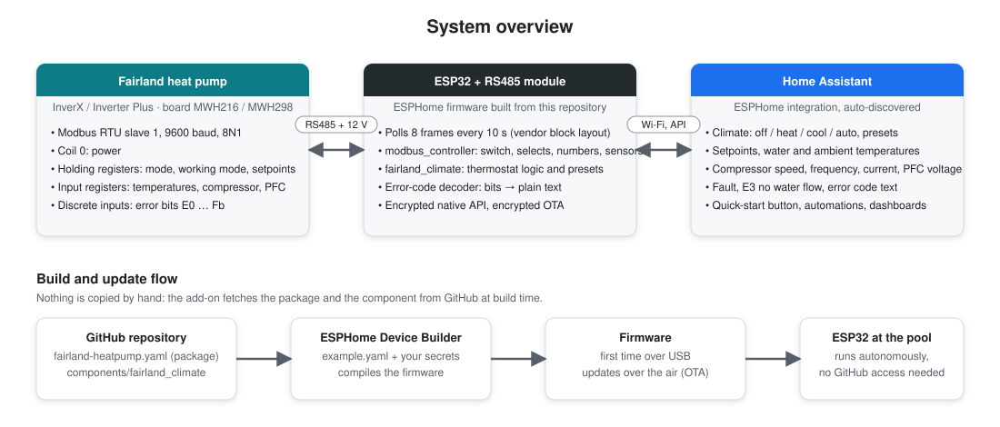
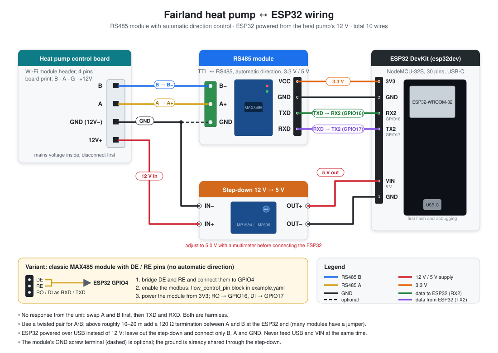

# ESPHome for Fairland Pool Heat Pumps

[](LICENSE)


Native ESPHome integration for Fairland **InverX** and **Inverter Plus** pool heat pumps over
Modbus RTU (RS485). An ESP32 talks directly to the heat pump's control board and exposes all
readings and controls to Home Assistant through the ESPHome API. No cloud account, no Tuya,
no Home Assistant Modbus integration.

The project is designed for the ESPHome Device Builder add-on: the device configuration pulls
the heat pump package and the climate component from this repository at build time.



## Features

- Power switch, operating mode (Auto / Heating / Cooling), working mode (Smart / Silence /
  Super Silence / Turbo) and target temperature
- Water inlet, outlet and ambient temperature, compressor speed, frequency and current,
  PFC voltage
- Error codes decoded to plain text, plus fault and no-water-flow indicators
- Climate (thermostat) entity with presets for the Home Assistant thermostat card
- Encrypted API, encrypted OTA updates, captive-portal fallback

## Supported devices

Fairland heat pumps with the MWH216 / MWH298 control board:

- InverX series: IXR / IXCR 26–110 and the current generation (e.g. InverX 13, model NPCR14)
- Inverter Plus series (e.g. IPHCR45)
- Rebranded units with the same board (e.g. Pool Systems IPS Pro)

Protocol: Modbus RTU, 9600 baud, 8 data bits, no parity, 1 stop bit, slave address 1.

## Repository layout

| Path | Description |
|---|---|
| `example.yaml` | Device configuration for the ESPHome add-on (board, Wi-Fi, API, OTA, package include) |
| `fairland-heatpump.yaml` | ESPHome package: UART, Modbus, entities and climate |
| `components/fairland_climate/` | External component: climate entity and error-code decoder |
| `secrets.yaml.example` | Secrets expected by `example.yaml` |
| `docs/` | Wiring diagram and system overview |
| `LICENSE` | MIT license |

## Hardware

- ESP32 DevKit (`esp32dev`, WROOM module)
- RS485 transceiver module (MAX485 / MAX3485 breakout). A module with automatic direction
  control and 3.3 V operation is recommended. Modules with DE/RE pins work as well and need one
  extra GPIO (see `flow_control_pin`).
- Step-down converter 12 V → 5 V (e.g. MP1584 or LM2596), adjusted to 5.0 V before connecting
- Twisted pair for A/B plus two wires for 12 V, e.g. from a network cable

### Connector on the heat pump

The control board has a four-pin header for the optional Wi-Fi module, labelled
**B · A · GND (12V−) · 12V+**. On many units this header is already wired to a connector on the
outside of the cabinet.

> **Warning:** The heat pump contains mains voltage and large capacitors. Disconnect all poles
> before opening the unit. Work at your own risk; modifications may void the warranty.

### Wiring



| From | To | Note |
|---|---|---|
| Heat pump **B** | RS485 module **B** (B−) | |
| Heat pump **A** | RS485 module **A** (A+) | |
| Heat pump **12V+** | Step-down **IN+** | |
| Heat pump **GND** | Step-down **IN−** | shared ground with the non-isolated step-down |
| Step-down **OUT+ (5 V)** | ESP32 **VIN / 5V** | |
| Step-down **OUT−** | ESP32 **GND** | |
| ESP32 **3V3** | RS485 module **VCC** | ESP32 inputs are not 5 V tolerant; run the module at 3.3 V or level-shift RO |
| ESP32 **GND** | RS485 module **GND** | |
| ESP32 **GPIO17** (TX) | RS485 module **DI** | substitution `tx_pin` |
| ESP32 **GPIO16** (RX) | RS485 module **RO** | substitution `rx_pin` |
| ESP32 **GPIO4** (optional) | RS485 module **DE + RE** (bridged) | only without automatic direction control, see `flow_control_pin` |

- No response from the unit: swap A and B first, this is the most common mistake.
- Termination: for long cables (more than about 10–20 m) place a 120 Ω resistor between A and B
  at the ESP end. Many modules provide a jumper or a populated R0/120R for this.
- The 12 V supply of the control board is sufficient for the ESP32 and the RS485 module.
  Alternatively power the ESP32 over USB and connect only B, A and GND.

## Installation

Requirements: ESPHome Device Builder add-on 2026.9 or newer (the package uses
`reuse_previous_range`, `custom_pdu` and OTA encryption).

1. In the add-on open **Secrets** and add the entries from `secrets.yaml.example`:
   `wifi_ssid`, `wifi_password`, `ap_password` and `api_encryption_key` (32 random bytes,
   base64; the key the add-on generates for a new device can be reused).
2. Click **New device**, choose a name (e.g. `fairland-heatpump`) and **ESP32**, then **Skip**
   the installation.
3. Open the device with **Edit**, replace the content with [`example.yaml`](example.yaml) and
   adjust `name`, `friendly_name` and, if needed, the pin substitutions. Save.
4. Click **Install**. For the first flash connect the ESP32 over USB and choose
   **Plug into this computer** (or **Manual download** and flash with
   [ESPHome Web](https://web.esphome.io)). Later updates go **Wirelessly**.
5. Home Assistant discovers the device through the ESPHome integration. Enter the API key
   when adding it.

The add-on downloads the package and the component from GitHub and caches them for one day
(`refresh: 1d`). **Clean Build Files** does not touch this cache. To pick up a new version sooner,
use the long form with a shorter refresh interval:

```yaml
external_components:
  - source: github://King007t/esphome-fairland-heatpump@main
    components: [fairland_climate]
    refresh: always

packages:
  fairland:
    url: https://github.com/King007t/esphome-fairland-heatpump
    file: fairland-heatpump.yaml
    ref: main
    refresh: always
```

<details>
<summary>Alternative: ESPHome CLI</summary>

Clone the repository, create `secrets.yaml` from `secrets.yaml.example` (replace the API key
placeholder with a generated key) and run:

```bash
esphome run example.yaml
```

To use the local copies of the package and the component instead of GitHub, replace the
`external_components` source with `type: local, path: components` and the package line with
`!include fairland-heatpump.yaml`.
</details>

## Configuration

The device configuration (`example.yaml`) owns board, network and credentials. Everything else
comes from the package and can be adjusted by overriding substitutions or merging into the
package blocks:

| Setting | Where | Default |
|---|---|---|
| `name`, `friendly_name` | `substitutions` in the device configuration | `fairland-heatpump`, `Fairland Heat Pump` |
| `tx_pin`, `rx_pin` | `substitutions` in the device configuration | `GPIO17`, `GPIO16` |
| `update_interval` | `substitutions` in the device configuration | `10s` |
| `flow_control_pin` | add a `modbus:` block with `id: modbus_bus` and the pin, see the end of `example.yaml` | not set (automatic direction control) |

Further options:

- **Turbo:** not every model accepts working mode 3. If the unit rejects it, the select reverts on
  the next read. To remove the option, copy the package into the add-on and edit `optionsmap`.
- **Target temperature ranges:** `min_value` / `max_value` of the three setpoint numbers
  (Heating 18–40 °C, Cooling 12–30 °C, Auto 12–40 °C, as specified in the vendor protocol).
  The unit reports the limits it actually enforces in the `Setpoint Minimum` / `Setpoint Maximum`
  diagnostic sensors; adjust the numbers if they differ. The climate entity adopts the ranges
  automatically.
- **Logging:** register values are logged at the default `DEBUG` level. To see the raw Modbus
  frames add to the device configuration:

  ```yaml
  logger:
    logs:
      modbus: VERBOSE
  ```

## Entities

| Entity | Type | Register | Note |
|---|---|---|---|
| Status | binary_sensor | coil 0 | unit on/off |
| Power | switch | coil 0 | disabled by default |
| Fault | binary_sensor (problem) | DI 48–95 | any error code active |
| E3 No Water Flow | binary_sensor (problem) | DI 51 | protection message |
| Fault Indicator DI16 | binary_sensor, diagnostic | DI 16 | vendor summary bit, not present on all firmware versions |
| Error Code | text_sensor | DI 48–95 | e.g. `E3: No water flow (protection)` |
| Compressor | sensor % | IR 0 | compressor speed |
| PFC Voltage | sensor V | IR 2 | DC link voltage |
| Inlet Temperature | sensor °C | IR 3 | water inlet, used as current temperature |
| Outlet Temperature | sensor °C | IR 4 | |
| Ambient Temperature | sensor °C | IR 5 | |
| Heat Exchanger Temperature | sensor °C, diagnostic | IR 9 | titanium heat exchanger |
| Compressor Frequency | sensor Hz, diagnostic | IR 10 | |
| Compressor Current | sensor A | IR 11 | raw value × 0.1 |
| Auto / Heating / Cooling Setpoint Minimum and Maximum | 6 × sensor °C, diagnostic | IR 15–20 | limits reported by the unit, polled every 10 min; unknown on firmware that leaves them at 0 |
| Mode | select | HR 0 | Auto / Heating / Cooling, disabled by default |
| Working Mode | select | HR 1 | Smart / Silence / Super Silence / Turbo, disabled by default |
| Heating Target Temperature | number | HR 3 | 18–40 °C, step 1, disabled by default |
| Cooling Target Temperature | number | HR 4 | 12–30 °C, step 1, disabled by default |
| Auto Target Temperature | number | HR 2 | 12–40 °C, step 1, disabled by default |
| Heat Pump | climate | coil 0, HR 0–4, IR 3 | thermostat with presets |
| Restart | button, diagnostic | | restarts the ESP32 |

Entity names are prefixed with `friendly_name` in Home Assistant (e.g. `Fairland Heat Pump Power`).

The climate entity is the intended control; the underlying switch, selects and numbers are created
disabled in Home Assistant to keep the device page clean. Enable them in the entity settings if you
need them for automations or dashboards. The flag applies when an entity is first registered, so on a
device that was added earlier the entities keep their current state.

### Climate entity

The climate entity is implemented in `components/fairland_climate` and is composed of the
entities above, so it generates no additional Modbus traffic.

- Current temperature: inlet temperature (IR 3). Target temperature: the setpoint of the active
  mode, i.e. HR 3 (Heating), HR 4 (Cooling) or HR 2 (Auto). The unit keeps one setpoint per
  mode; the climate entity shows and writes the one that applies.
- HVAC modes: `off` clears coil 0. `heat`, `cool` and `auto` set coil 0 and write HR 0
  (1 = Heating, 2 = Cooling, 0 = Auto). When the unit was off, the mode is written after
  `power_on_delay` (default 5 s).
- Presets: the options of the `Working Mode` select (Smart, Silence, Super Silence, Turbo).
- Action (heating / cooling / idle) is derived from the compressor speed.
- After a command the requested mode is shown until the unit confirms it; the real state is
  adopted with the next polling cycle at the latest.

Suggested Home Assistant thermostat card features: `climate-hvac-modes` and
`climate-preset-modes`.

## Error codes

The error bits (discrete inputs 48–95) are read in a single frame and translated in
`components/fairland_climate/fairland_errors.cpp`. Several active codes are joined with ` | `;
without any code the text sensor reads `No fault`. The `Fault` and `E3 No Water Flow` binary
sensors are derived from the same frame.

| Code | DI | Description | Type |
|---|---|---|---|
| E1 / E2 | 49 / 50 | High / low pressure protection | failure |
| E3 | 51 | No water flow | protection |
| E4 | 52 | 3-phase sequence protection (three-phase units only) | failure |
| E5 | 53 | Power supply outside operating range | protection |
| E6 | 54 | Insufficient water flow (excessive inlet/outlet temperature difference) | protection |
| E7 | 55 | Water outlet temperature too high or too low | failure |
| E8 | 56 | High exhaust temperature protection | failure |
| EA | 58 | Evaporator overheat protection (cooling mode) | failure |
| Eb | 59 | Ambient temperature too high or too low | protection |
| Ed | 61 | Anti-freezing reminder | protection |
| P0 | 64 | Controller communication failure | failure |
| P1 – P8 | 65–72 | Sensor failure: water inlet, water outlet, gas exhaust, evaporator coil, gas return, cooling coil, ambient, cooling plate | failure |
| P9 / PA | 73 / 74 | Current sensor failure / restart memory failure | failure |
| F1 – F4 | 81–84 | Compressor drive module, PFC module, compressor start, compressor running failure | failure |
| F5 – F9 | 85–89 | Inverter board over-current, inverter board overheat, current protection, cooling plate overheat, fan motor failure | failure |
| FA / Fb | 90 / 91 | PFC module over-current / power filter board no-power protection | failure |
| E0, E9, F0 | 48, 57, 80 | not documented by the manufacturer | unknown |

E3, E5, E6, Eb and Ed are protection messages, not device failures. After power-on the unit
performs a system check for about three minutes; E3 is shown until the circulation pump
provides flow.

## Modbus register reference

Temperatures of "type 1": `°C = (raw − 60) / 2`, written as `raw = °C × 2 + 60`.

| Type | Address | Content | Values |
|---|---|---|---|
| Coil (FC01/05) | 0 | Power | 0 off, 1 on |
| Coil | 1 | Forced defrosting | 1 = start (unused) |
| Discrete input (FC02) | 0 / 1 | Power status / defrosting | |
| Discrete input | 16 | Malfunction / protection indicator | not on all firmware versions |
| Discrete input | 48–95 | Error bits E0 … Fb (92–95 reserved) | see table above |
| Input register (FC04) | 0 | Compressor speed | % |
| Input register | 1 | Compressor target frequency | Hz |
| Input register | 2 | PFC voltage | V |
| Input register | 3 / 4 / 5 | Water inlet / water outlet / ambient temperature | type 1 |
| Input register | 6 / 7 / 8 / 9 | Gas exhaust (type 2: ÷ 2) / evaporator / gas return / inner coil temperature | |
| Input register | 10 / 11 | Compressor frequency Hz / compressor current 0.1 A | |
| Input register | 12 / 13 / 14 | Cooling plate temperature (type 2) / EEV opening / fan speed | |
| Input register | 15–20 | Setpoint limits: auto min / max, heating min / max, cooling min / max | type 1, InverX firmware |
| Holding register (FC03/06) | 0 | Mode | 0 Auto, 1 Heating, 2 Cooling |
| Holding register | 1 | Working mode | 0 Smart, 1 Silence, 2 Super Silence, 3 Turbo |
| Holding register | 2 / 3 / 4 | Target temperature Auto / Heating / Cooling | type 1, heating range 18–40 °C |
| Holding register | 5 / 6 | Water pump mode / run time | unused |
| Holding register | 25 | Power-off restart memory | 1 = restore last state |

The vendor protocol describes block reads: input and holding registers in blocks of three
starting at 0, 3, 6, …, and the error bits as a block of 48. The package reads input registers
0–2, 3–5 and 9–11, holding registers 0–2 and 3–4, the error bits 48–95, coil 0 and discrete
input 16: eight frames per polling cycle, with at least 100 ms between frames. The setpoint
limits (input registers 15–17 and 18–20) are polled by a second controller every ten minutes.

## Troubleshooting

| Symptom | Cause / fix |
|---|---|
| `Modbus error`, no values, entities unavailable | A/B swapped, missing GND, wrong pins, module without automatic direction control but no `flow_control_pin` |
| Only CRC errors in the log | Check baud rate and parity (9600 8N1), long cable without termination, interference (use twisted pair) |
| Values arrive but with occasional gaps | Increase `turnaround_time` to 200 ms (merge into the `modbus:` block like `flow_control_pin`) |
| Mode or working mode reverts after setting | Value rejected by the unit (e.g. Turbo), or unit was off: power on first |
| E3 after power-on | Normal until the circulation pump provides flow |
| Fault Indicator DI16 never turns on | Not implemented by this firmware; `Fault` uses the error block instead |
| Build still uses an old version of this repository | The cached copy is refreshed once a day; set `refresh: always` (see Installation) to force an update. **Clean Build Files** does not refresh the cache |

## License

This project is released under the [MIT License](LICENSE).

## Credits

- [spdr870/fairland_iphcr45_modbus](https://github.com/spdr870/fairland_iphcr45_modbus): Home Assistant Modbus setup and register documentation
- [rstcologne/ESP-Home-Fairland-Heatpump](https://github.com/rstcologne/ESP-Home-Fairland-Heatpump): ESPHome reference and serial parameters
- [Home Assistant Community: Controlling a Fairland Pool Heatpump eliminating Tuya](https://community.home-assistant.io/t/controlling-a-fairland-pool-heatpump-eliminating-tuya/579467)
- [Fairland InverX installation and user manual](https://fairland.gr/wp-content/uploads/2024/06/USER-INSTALLATION-MANUAL-FAIRLAND-InverX-Horizontal.pdf): failure code table, heating setpoint range 18–40 °C
- [Fairland Inverter Plus installation and user manual](https://www.heatpumps4pools.com/myfiles/file/inverter-plus-vertical-user-manual.pdf): identical failure code table
- [ESPHome modbus_controller](https://esphome.io/components/modbus_controller/)
